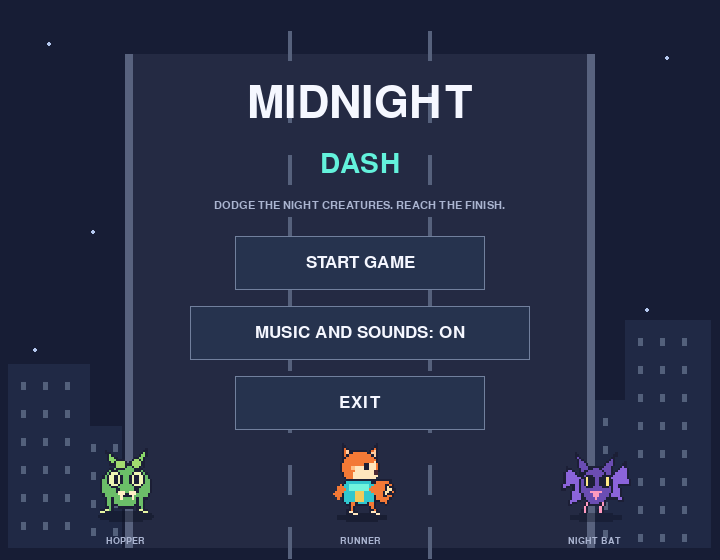
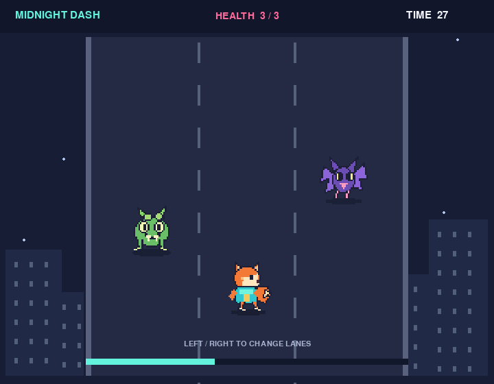
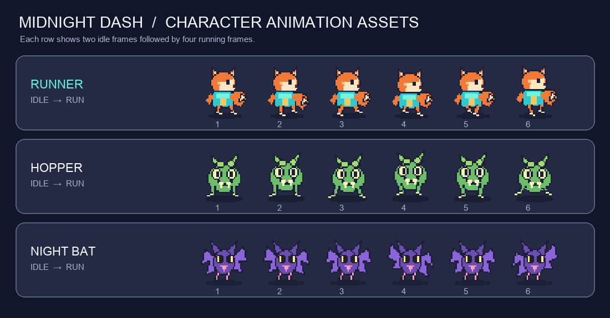

# Midnight Dash

Midnight Dash is a small three-lane runner made with Python and Pygame Zero. Move between lanes to dodge the Hopper and Night Bat, and survive for 45 seconds to reach the finish.

## Screenshots

### Main menu



### Gameplay



## Character animation preview

The preview shows the two idle frames and four running frames shipped for each character.



## Features

- Three lanes with left and right movement.
- Two animated enemies that patrol within restricted lane pairs.
- Collisions only happen when an enemy is on the runner's lane and close enough vertically.
- Three health points and a short invulnerability window after a hit.
- A 45-second survival goal, main menu, audio toggle, and result screen.
- Original sprite, sound effect, and music assets included in the project.

## Controls

| Key or input | Action |
| --- | --- |
| Left Arrow | Move one lane left |
| Right Arrow | Move one lane right |
| Enter | Start or replay |
| Mouse | Select menu buttons |

## Requirements

- Python 3.13 (recommended)
- Pygame Zero

On macOS or Linux, create a virtual environment, activate it, and install Pygame Zero:

```bash
python3.13 -m venv .venv
source .venv/bin/activate
python -m pip install pgzero
```

On Windows PowerShell, use:

```powershell
py -3.13 -m venv .venv
.venv\Scripts\Activate.ps1
python -m pip install pgzero
```

## Run the game

From the project folder, run:

```bash
pgzrun game.py
```

If `pgzrun` is not on your PATH while the virtual environment is active, run it directly:

```bash
./.venv/bin/pgzrun game.py
```

## Project files

```text
game.py       Game logic
images/       Runner and enemy animation frames
sounds/       Menu, collision, win, and loss sound effects
music/        Background soundtrack
screenshots/  Menu, gameplay, and character previews
README.md     Project overview and setup guide
readme.txt    Short run instructions
```

Pygame Zero provides the game loop, drawing, input, animation actors, and audio. The game source does not import Pygame directly or require additional Python libraries.
